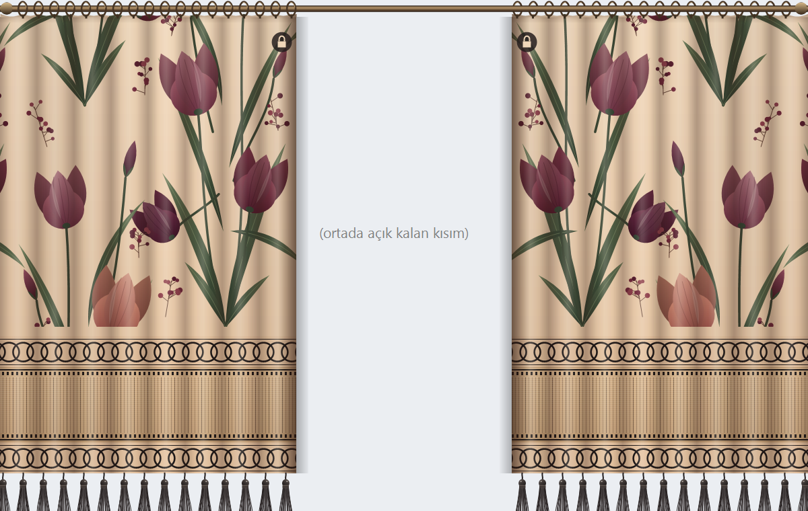
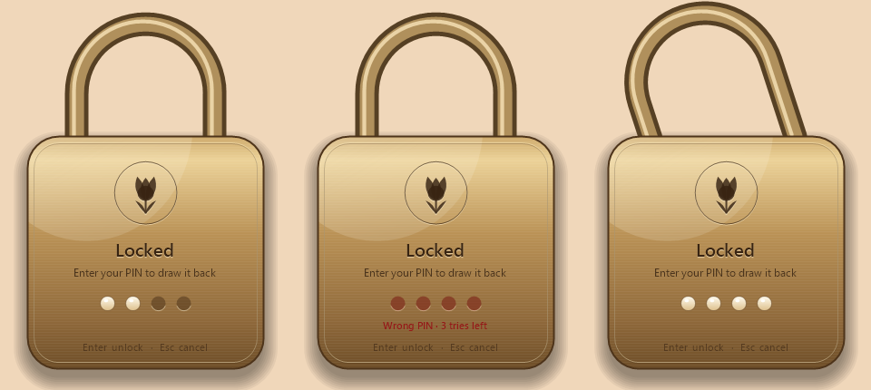

# Desktop Curtain 🌷

**A real curtain for your screen.** Double-tap Ctrl, draw a tulip-patterned curtain across your screen, and it locks the moment you let go. Getting it back open takes your PIN.

Someone walks up behind you? Double-tap Ctrl and pull the curtain over whatever you were looking at. Cover half the screen and keep working on the other half, or close it all the way.

## Features

- **Two panels.** Double-tap **right Ctrl** for the right panel, **left Ctrl** for the left one. Use one, or both like a real pair of curtains.
- **Pull it as far as you want.** Grab the fabric and drag it. The uncovered part of the screen keeps working normally.
- **Locks on release.** A locked panel won't move in either direction. Try to drag it and it stretches, springs back, and asks for your PIN.
- **Feels like fabric.** Touch it and the cloth ripples from where you touched. The tassels swing like little pendulums and slowly settle.
- **Hangs from a real rod.** Bronze rod, rings that bunch together as the curtain gathers, and a heading that sags softly between the rings.
- **Brass padlock PIN screen.** Wrong PIN and the lock shakes. Right PIN and the shackle pops open.

## Getting started

Requires **Windows 10 or 11**. Nothing to install: it runs on the .NET Framework and PowerShell that ship with Windows.

1. Download this repository (**Code → Download ZIP**) and unzip it anywhere.
2. Double-click **`Start.vbs`**.
3. On first launch, set a 4–8 digit PIN.

To start it automatically when Windows starts, press `Win + R`, type `shell:startup`, and put a shortcut to `Start.vbs` in the folder that opens.

## Controls

| Action | How |
| --- | --- |
| Bring out / put away the right panel | Double-tap **right Ctrl** |
| Bring out / put away the left panel | Double-tap **left Ctrl** |
| Close a panel | Drag the fabric |
| Close a panel all the way | Double-click the fabric |
| Unlock a panel | Try to drag it, then type your PIN and press Enter |
| Quit | **Ctrl + Alt + Shift + P** (asks for the PIN if a panel is locked) |

`Ctrl + Alt + P` also toggles the right panel, as a fallback.

## Custom pattern

Don't want tulips? Put an image named `desen.png` or `desen.jpg` next to `Start.vbs` and the curtain will use it instead.

## Privacy and how it works

- **Keyboard.** To detect a double-tap on Ctrl, the app listens to the keyboard through a standard Windows hook. It only reacts to the Ctrl keys, plus the digit, Enter, Backspace and Esc keys while the PIN padlock is on screen, so your PIN reaches the lock even if another window has focus. Nothing is logged, stored or sent anywhere. Some antivirus tools flag keyboard hooks in general. The full source is in [`Curtain.cs`](Curtain.cs) if you want to check.
- **Your PIN** is stored as a salted PBKDF2 hash in `%APPDATA%\MasaustuPerdesi\pin.dat`, never in plain text.
- **Forgot your PIN?** Quit the app (or end the `powershell.exe` process running `DesktopCurtain.ps1` in Task Manager), delete `pin.dat`, and start it again to set a new one.
- **Why a `.vbs` and not an `.exe`?** Windows Smart App Control blocks unsigned executables. So `Start.vbs` launches PowerShell, which compiles `Curtain.cs` in memory and runs it. Everything stays readable source.
- **It's a privacy screen, not encryption.** It hides your screen from people looking over your shoulder. Your files stay exactly as they are and are still reachable through File Explorer.

## Türkçe

Ekranınız için gerçek bir perde. Sağ ya da sol Ctrl'ye iki kez basın, lale desenli perdeyi istediğiniz yere kadar çekin. Bıraktığınız an kilitlenir, geri açmak için PIN gerekir. Başlatmak için `Start.vbs` dosyasına çift tıklayın.

## License

[MIT](LICENSE) © 2026 kutcodelabs
